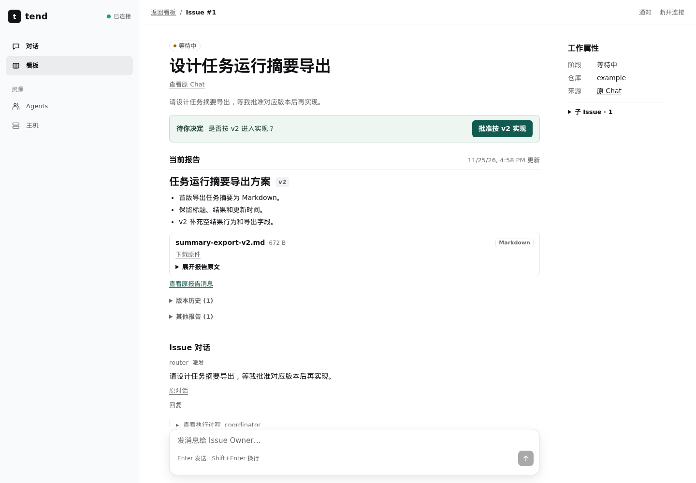
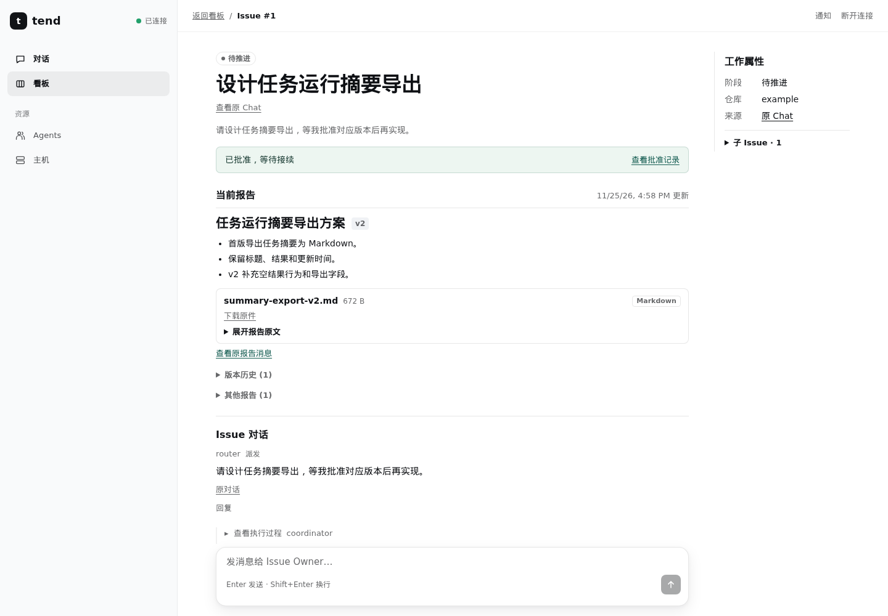
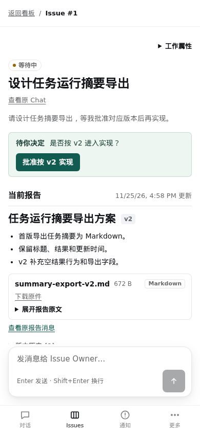
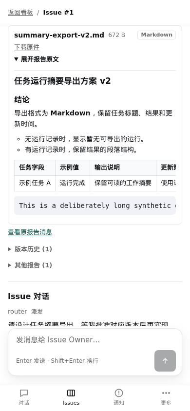
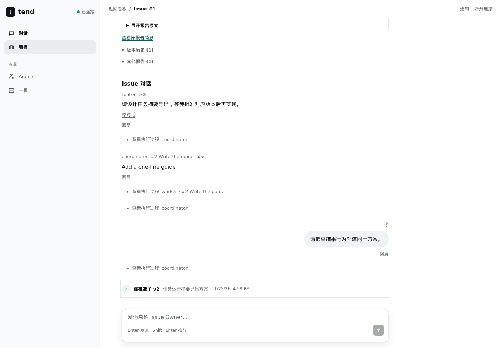

# Inline proposal approval

## Goal and limits

Present an explicitly versioned proposal, its report, and the original Issue discussion in one document. The Issue and original Chat show one recorded user decision. Existing questions remain ordinary questions. This design does not act on any existing live question, copy production content, or authorize deployment.

## Phases

1. Freeze the synthetic [design reference](mockups/inline-proposal-approval.html).
2. Add explicit proposal authoring for a report and a concrete approval action. Store immutable candidate versions under the original Attention. Do not turn older questions or other reports into proposals by inference.
3. Validate the exact version at the shared CLI and Web API. Commit the decision, original Task input and Issue timeline placement atomically. The handoff uses the existing AttentionAnswered input and its actual native Run evidence. No Router turn or Chat message is created by approval.
4. Add the Issue approval strip, report and collapsed history, original Chat action or status, and paginated non-message approval events. Use the existing Markdown renderer and artifact boundary. Keep independent or ambiguous decisions available in their original Chat.
5. Verify an immutable candidate before pushing main. Download and check the official main build for that SHA. No deployment.

## Verification

- Verify revision identity, stale writes, duplicate clicks, lost responses, exact report and Task ownership, independent decisions, and absence of extra Chat or Router inputs. Exercise delayed Run takeover, including a Run that has not started its native turn.
- Verify ordinary questions and previous client and Runner wire shapes. Keep proposal metadata out of delivered Runner inputs.
- Use isolated synthetic data for desktop and mobile Chromium inspection. Exercise the normal Issue entry, approval, original Chat, property disclosure, Markdown scrolling, and history. Preserve original screenshots separately.

## Implemented contract

- The top-level Issue Owner submits a formal report via `tend_report_result`, then calls `tend_propose_approval` with its operation ID, one published Markdown original, a concise question, and the concrete next action. The initial version is 1. A revision names the original Attention with `replaces`, increments the version by one, and supplies a new report and original. These are Runner-local acceptance receipts, not confirmation of the Server projection. Check the original Chat or Issue to confirm publication.
- The Server validates report membership, owning Task, unresolved state, and revision order. An initial declaration whose report cannot be bound keeps a concrete ordinary question for clarification. An invalid or racing revision does not change the accepted version or create another wait.
- Dedicated one-click publication uses the original Chat Attention. Plain replies cannot settle a structured proposal. Existing ordinary replies still use the Router. When multiple unresolved decisions coexist, Issue links to the original Chat choices without an inline write. Chat and CLI identify one Attention and one exact version.
- The single decision row links to `AttentionAnswered` and supplies the approval event and continuation status. Approval creates no Chat message, Router input, or Task. Several clicks and retries for the same version return the same decision ID. Continuation only appears when the native turn for that exact input is observed.
- Server sync advertises proposal authoring additively. Older Runners do not need the authoring tool to continue a Task. Handoff carries the original plain wait and the existing answer payload, not proposal metadata. Older clients can still use ordinary Attentions.

- If the original Task stops before a native Run starts with the approval input, keep the approved version and input on that Task. Surface the blocked takeover without inventing a native Run or letting unrelated follow-up work consume the approval.
- A proposal in an older page of the original Chat refreshes by its stable Attention ID. Its current version and decision do not depend on the question remaining among the latest messages.

## Rendered verification

The final synthetic Chromium captures exercise the approval document at 1440×1000 and 390×844, the expanded Markdown boundary, and the linked approval event in the Issue timeline.

