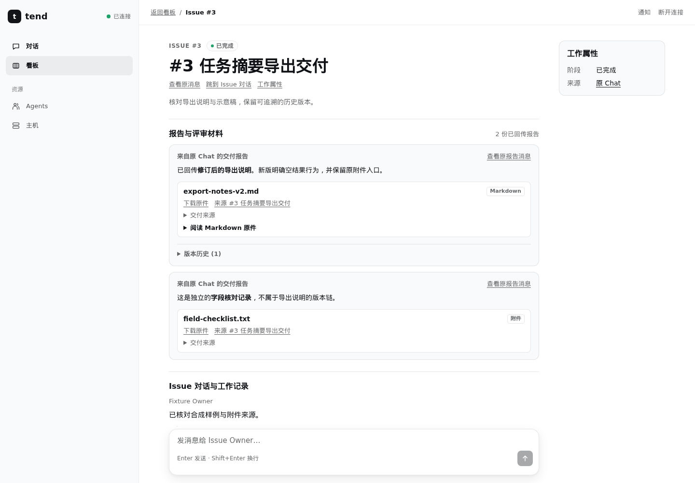
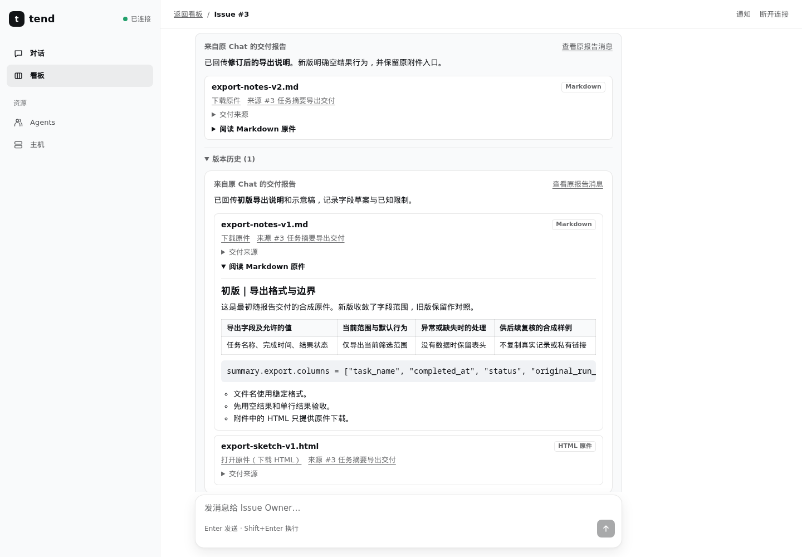
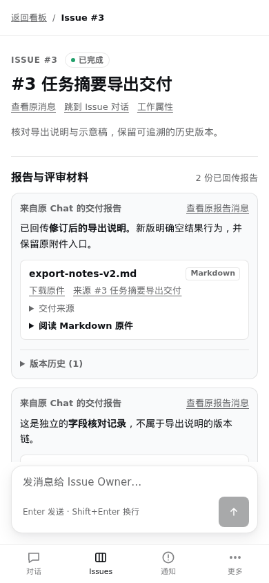
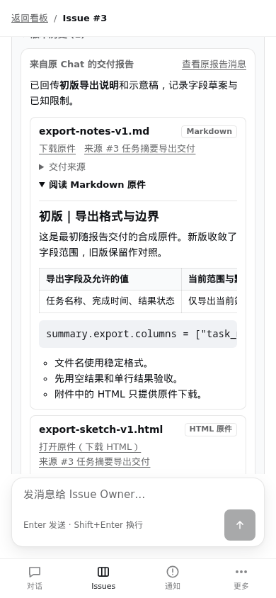

# Ordinary report version backfill

## Goal and scope

Let an operator explicitly attach an already published ordinary report as the historical version of another ordinary report on the same Issue. The Issue shows one current report per declared chain and keeps each original message and its files reachable. Independent reports and the structured proposal approval flow keep their existing behavior.

## Phases and data rules

1. Add an additive Server migration for directed edges and operation receipts. Within one immediate transaction, validate the Issue source topic, ordinary report identity, any Router input, and both exact publication messages. Use an existing mapping only when it is unambiguous and agrees with an explicitly supplied message. For an absent mapping require the original reply's ID. Never infer a write from file, text, or timing. Reject forks, merges, reused message identities, proposal candidates, and cycles before saving either missing mapping.
2. Expose the authenticated Server operation through the CLI. Pin publication IDs on each accepted edge. Replays with the same operation identity return the saved result, while the exact same relation under a fresh operation identity stays one edge. Expose the same Issue report projection to Web and CLI, without replacing the existing lightweight Issue API.
3. Reuse the current report article and attachment renderer inside native, collapsed version history. Keep proposal approval and its layout in place. Only the Issue detail projection changes.
4. Verify with an isolated SQLite/HTTP fixture, two competing database connections, and the final Web page rendered by Chromium. Exercise closed and expanded history at desktop and phone widths, Markdown, original links, attachments, and proposal regression. Push a fast-forward commit to main, then verify official Main CI and download and compare both SHA-bound archives.

This work does not re-publish a report, change Chat messages or files, create approvals or Attention, schedule/wake work, add Agent or Runner inputs, add a new Agent tool, or deploy. No production records, trial backfills, or live Attention are used.

## Implemented contract

Write through the authenticated `POST /api/v1/report-revisions`. The JSON body takes `operation_id`, `old_report_id`, `new_report_id`, and optional `old_message_id` and `new_message_id`. Report IDs are the original `tend_report_result` WorkOperation IDs. Each omitted message must already have exactly one matching publication mapping. Supply its exact original reply ID when no mapping exists. A user reply, unrelated Router reply, known Attention message, or reply already bound to another report is not a report publication. A recorded `router_inputs` row must agree with the Issue source topic and have completed successfully. A pending or failed input cannot claim an earlier reply, even on the same topic. A historical report with no surviving input row can still be bound explicitly. Reports named by a structured proposal declaration, including a declaration not accepted as a version, are ineligible.

```sh
tend report backfill <old-report-id> <new-report-id> [operation-id] [--old-message <message-id>] [--new-message <message-id>]
```

For example, with synthetic IDs:

```sh
tend report backfill old new backfill-fixture --old-message msg-old --new-message msg-new
```

The HTTP 200 receipt contains `operation_id`, `issue_id`, `old_report_id`, `new_report_id`, `old_message_id`, `new_message_id`, and `created`. Keep the operation ID for the same logical retry after a lost response. Replaying the same operation and identities returns the original receipt, including its original `created` value. The CLI retries transport failures with the same ID and prints it in the error context if the call fails. A fresh operation ID against an already recorded, matching edge returns `created: false`; it records a receipt, not another edge. Reusing an operation ID with conflicting identities, or trying to create a fork, merge, or cycle, returns 409. Invalid IDs, missing required arguments, self-reference, and non-ordinary candidates return 400. Nonexistent reports and publication messages return 404. Topic, role, and mapping mismatches return 409. No rejection leaves a new mapping, edge, or receipt behind.

Both `GET /api/v1/issues/{issue}/overview` and `GET /api/v1/issues/{issue}?include=reports` use the same report projection. The CLI uses the latter, which preserves the ordinary Issue fields; the API without the query stays lightweight. Each chain head appears once in `reports`; `history` is ordered with the immediately previous version first. Both head and historical versions carry the original publication text, message ID, and immutable report file references with their existing provenance. A standalone report keeps its existing layout. A legacy report matched only for display has no known `report_id`, and cannot be used for backfill from that match alone. If an author later registers an endpoint as an actual structured proposal version, the proposal projection takes precedence and the ordinary chain stops at that endpoint; an already saved receipt still proves the historical backfill transaction.

Read-only verification by Issue number:

```sh
tend issue read '#123' | jq '.reports[] | select(.history != null) | {report_id, message_id, text, artifacts, history: [.history[] | {report_id, message_id, text, artifacts}]}'
```

## Rendered verification

The browser fixture opens the real Issue detail, confirms the current and independent reports and the initially collapsed history, then opens the old version and its Markdown original. It checks the original Chat link, old Issue anchor, and HTML download. Browser plugin was unavailable in this session, so the repository's Playwright and local Chromium were used.









## Local verification

Use Rust 1.91.1 as in Main CI, and Node 24 for Web. Run the following from the repository root.

```sh
cargo +1.91.1 test -p tend-server report
cargo +1.91.1 test --workspace --locked
cargo +1.91.1 build --release --locked
pnpm --dir web typecheck && pnpm --dir web lint && pnpm --dir web test && pnpm --dir web format:check && pnpm --dir web build
TEND_SCREENSHOTS="$PWD/docs/plans/images" python3 -B tests/e2e/report_revision.py target/release/tend-server target/release/tend target/release/tend-runner --web
python3 -B tests/e2e/issue_detail.py target/release/tend-server
python3 -B tests/e2e/proposal_approval.py target/release/tend-server target/release/tend target/release/tend-runner --web
python3 -B tests/e2e/protocol_window.py target/release/tend-server target/release/tend target/release/tend-runner
```

The focused Rust fixture exercises migration from v26, a late constraint failure, pending and failed inputs through genuine Router publication, and two SQLite connections actually blocked on the same write lock. The new e2e uses real Server, CLI, and Runner processes with synthetic App Server output. It drops the first HTTP response, checks the complete success and rejection matrix, verifies state in both databases before and after the backfill, and exercises the existing version-specific approval and continuation on its original Task. The browser fixture uses the production Web build at 1440×1000 and 390×844. It checks keyboard disclosure, layout widths, console errors, lazy Markdown preview, download bytes, and both Issue and Chat anchors. This is fixture evidence, not production or physical-device evidence.
